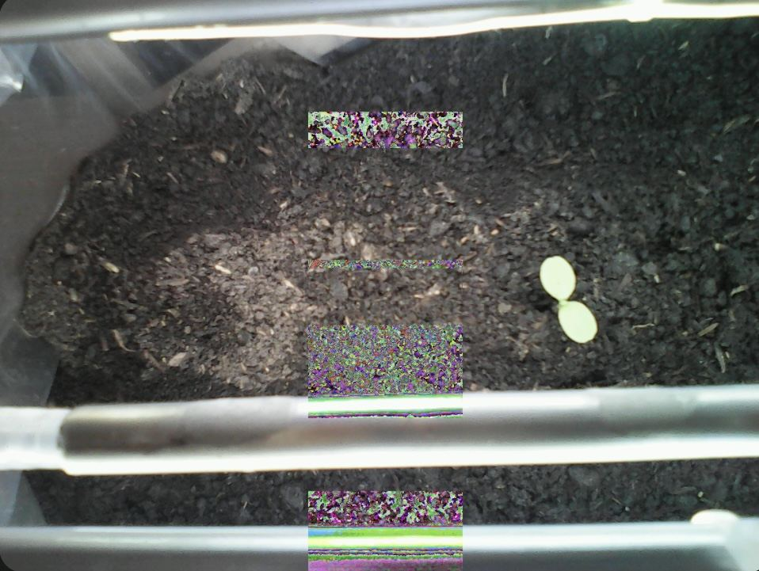
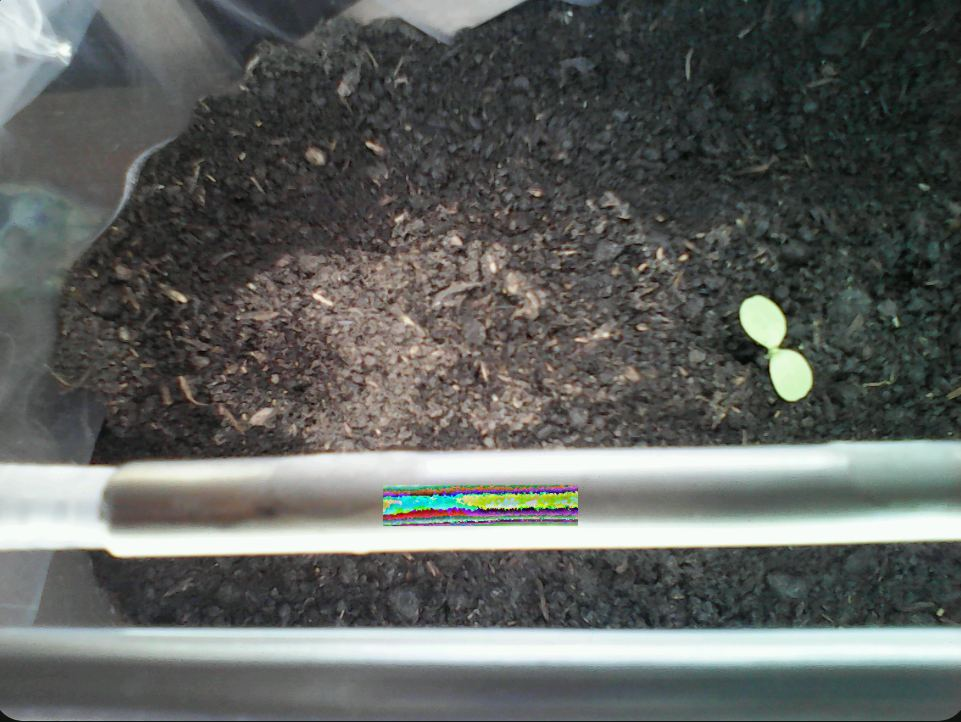
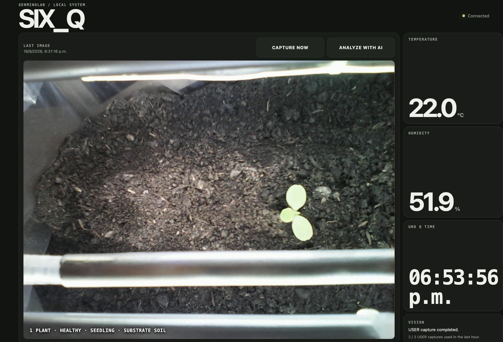
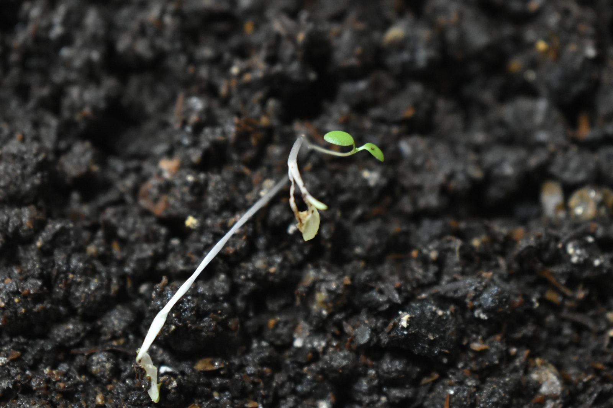
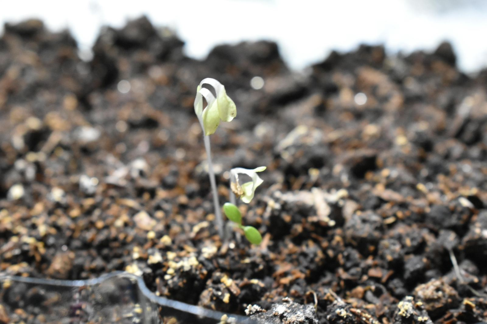

## How does the system work?

> **Experimental prototype — not for food production.** SIX_Q is intended for supervised experimentation. Do not use this version to grow food intended for human consumption. Materials in contact with water, substrate and plants must be evaluated before any food-growing use.

SIX_Q is an experimental automated growing system designed with local operation as a priority. The essential functions — irrigation, lighting, sensors, web dashboard, and image capture — can operate within the local network. Artificial intelligence is used only as an optional observation tool.

The Arduino UNO Q is divided into two layers:

- The microcontroller manages the physical controls, relays, environmental sensor, and communication with the Nicla Vision.
- The microprocessor, which runs Linux, hosts the local web dashboard, stores data, coordinates captures, and requests analysis through artificial intelligence.

The AHT20 sensor is connected through I²C Qwiic and provides periodic temperature and humidity measurements.
The system has two physical controls:

- The IRRIGATION pushbutton requests an approximately five-second cycle. A new request does not extend a cycle that is already running.
- The LIGHT switch represents the requested lighting state.

The physical controls and the web dashboard work in the same way: they request an action, but the UNO Q decides whether to activate the corresponding relay. The browser never directly controls the pump or the LED strip.
The submersible pump and the waterproof LED strip are connected through the Arduino 4 Relay Shield. In the prototype, irrigation is limited to a maximum of four accepted cycles, shared by manual and scheduled requests, per local calendar day, with the counter resetting at 00:00.

### Limitations ###

SIX_Q should be considered an experimental prototype for automation, sensors, computer vision, and AI-assisted monitoring. It should not yet be used to produce food intended for human consumption.
Before using it with edible crops, the materials that come into contact with the water, substrate, and growing environment must be evaluated, including plastics, tubes, adhesives, and structural elements.

The goal of this version is to demonstrate that an inexpensive and reproducible structure can combine:
environmental sensors + local controls + irrigation + lighting + computer vision + web dashboard + optional artificial intelligence analysis.

There are still aspects to improve, but that is a central part of the project: build, test, observe what fails, and develop a better version.

## Vision system

The Nicla Vision works as a visual sensor. The UNO Q uses I²C to send commands, states, and control signals. Image data, which is much larger, is transmitted through TCP over the local Wi-Fi network.
When CAPTURE NOW is pressed, the UNO Q authenticates the Nicla and starts the capture sequence. In the current implementation, the complete process takes approximately one minute and forty seconds and is limited to three captures per hour.

The camera captures the scene as 20 sections of 320 × 320 pixels, distributed across five columns and four rows. The UNO Q reconstructs these sections on a final 1600 × 1200-pixel canvas.
V7 uses the horizontal positions x = 0, 320, 640, 960, 1280 and the vertical positions y = 0, 320, 640, 880. The last row begins at y = 880, producing an 80-pixel vertical overlap with the previous row. This covers the final height exactly and facilitates mosaic assembly.
The column located at x = 640 uses a reinforced profile. In these cases, a wider sensor window is captured and then cropped to the final 320 × 320-pixel size.

During the initial preparation, the camera performs a stabilization period, discards warm-up frames, and adjusts its automatic controls. These controls are then locked to keep the capture conditions constant. In the reinforced tiles, one additional frame is also discarded before accepting the image.
Each accepted tile is transmitted over TCP to the UNO Q, where the mosaic is reconstructed and the PNG image displayed in the dashboard is generated.

## Historical mosaic problems

During the first versions, bands and color blocks began to appear within some images. At first, the problem was occasional, but it increased with operating time.

Versions V5, V5.1, and V6 were tested, and images, logs, and capture results were analyzed. The evidence showed that the anomalies were concentrated especially in the third mosaic column, associated with x = 640, although it was not possible to demonstrate a single physical cause. The behavior pointed to a possible interaction between the sensor window configuration, capture synchronization, and DCMI/DMA reception.

Version V7 modified the protocol to stabilize the sensor only once at startup, lock the automatic controls, use a reinforced capture in the problematic column, and validate the transfer state before accepting each tile. Some parts of the irrigation and lighting systems were also removed from the camera's field of view because they could cause reflections or interfere with focus.

In the tests performed with V7, the corruption pattern that motivated the investigation was not observed again. This should be understood as an experimental result of the protocol used, not as definitive proof of the original cause.

## Local web dashboard

The UNO Q hosts a web dashboard accessible from any device connected to the same local network.

### Network access and security

This prototype assumes a trusted private local network with access restricted to trusted users and devices. Restricting network access is part of the installation's security boundary; being on a local network alone does not authenticate a user.

The application does not implement dashboard user authentication or separate access permissions. Any client that can reach the dashboard can request irrigation, lighting, captures and AI analysis. The MCU still applies its actuator rules, but those rules do not identify the user. AI requests use the installation's configured API key and can incur charges.

Do not expose the dashboard or the camera TCP port directly to the Internet, through router port forwarding or public tunnels. The dashboard uses HTTP, and the image channel uses unencrypted TCP. Nicla authentication over I²C does not authenticate dashboard users or provide encryption or cryptographic authentication for the TCP image channel. This version is not intended for public or untrusted shared networks.

### Dashboard controls

The dashboard allows users to:

- check temperature and humidity;
- view the IRRIGATION and LIGHT status;
- request an irrigation cycle or select its program;
- turn the light on or select a program;
- request a new capture;
- view the latest image;
- request an analysis through artificial intelligence.

PROGRAM mode for irrigation and lighting is implemented and operational.

### PROGRAM and NOW rules

- Arduino owns relay decisions, schedules and quotas. Python supplies the local time configured in the UNO Q application; the browser does not schedule actions.
- WATER PROGRAM runs a 5-second pulse at the fixed local times listed below. Selecting or reselecting a program waits for the next scheduled time and does not repeat a past event.
- WATER NOW requests one pulse without cancelling or shifting the program. All accepted pulses share four slots per local calendar day, resetting at 00:00. Requests during an active pulse are rejected, never queued.
- Scheduled slots blocked by the quota or an active pulse are skipped. WATER OFF cancels the program but lets an accepted pulse finish.
- LIGHT PROGRAM uses daily local-time windows 06:00–12:00, 06:00–14:00, 06:00–18:00 or 06:00–00:00 (18 hours) and immediately follows the selected window.
- Manual LIGHT ON/OFF, including physical control, cancels the light program. Manual ON has no daily limit.
- The dashboard reads modes and irrigation usage from Arduino. Programs continue with the browser closed.
- Programs and quota counters live in RAM and reset on MCU restart. Water and lighting programs require an initial local date/time synchronization from Linux.

Some more advanced automations remain future work.

Local irrigation times (5-second pulses, subject to the daily quota):

| Program | Times |
|---|---|
| 4h | 00:00 · 04:00 · 08:00 · 12:00 · 16:00 · 20:00 |
| 6h | 00:00 · 06:00 · 12:00 · 18:00 |
| 8h | 00:00 · 08:00 · 16:00 |
| 12h | 00:00 · 12:00 |
| 24h | 12:00 |

The 4h program offers six slots, but this configuration permits four accepted irrigation pulses in total. NOW also consumes quota. Blocked slots are skipped, never queued. The counter resets at midnight even if a pulse is active: that pulse belongs to the day it was accepted. Backwards clock corrections do not replay slots or grant quota again. Normal scheduling latency within the first minute is allowed; earlier slots are not recovered.

The UNO Q application uses `America/Montevideo` as its local timezone. For another location, set the `SIXQ_TIMEZONE` environment variable to an IANA timezone. The dashboard clock, last-capture timestamp and lighting windows all use this zone, independently of the browser or container default timezone. Internal records retain UTC. The 24h irrigation program runs at 12:00 noon and shares the daily quota. This time is chosen by configuration; temperature does not enable or block irrigation.

## Analysis through artificial intelligence

Artificial intelligence analysis is optional and runs only when the user presses ANALYZE WITH AI.
The image is sent to the API, and the result is returned in a structured format describing:

- whether plants are visible;
- the number of plants detected;
- the general condition of the largest plant;
- the stage of development;
- the type of visible substrate.

The health assessment was adjusted using reference images of *Lactuca sativa*, including plants with insufficient irrigation and no LED lighting.

The analysis considers the following together:

- color and tone variation;
- leaf shape and development;
- stem extension and coloration;
- shoot development;
- retraction or loss of turgidity;
- deformities;
- the presence of brown tones or signs of necrosis.

A change in color alone is not automatically interpreted as disease, since it may depend on the intensity and type of lighting. For a plant to be classified as damaged, compatible morphological changes must also appear. When several plants are visible, the system reports the number detected and focuses the detailed assessment on the largest or most visibly developed plant.

The result is shown as an overlaid summary in the dashboard, on top of the captured image.
The model does not control the pump, lighting, or any other actuator. Artificial intelligence functions only as an additional layer of observation and interpretation.

## Requirements and approximate costs

To use the AI analysis, the following are required:

- a developer account;
- an API key;
- available credit or billing enabled;
- an Internet connection;
- a correctly captured image.

The key must not be included directly in public code. In this prototype, it is stored in a local secrets file excluded through `.gitignore`.

Configuration used during testing:

- Model: gpt-6-astra
- API: Responses API
- Reasoning: high
- Input: Base64-encoded PNG image
- Output: schema-validated JSON
- Timeout: 120 seconds

Cost and processing time depend on the model, image size, and token count. In the tests performed, the analysis took approximately 4 to 6 seconds with low reasoning and 6 to 10 seconds with high reasoning. The observed cost was close to USD 0.03–0.04 per request.
There is no automatic background usage: if the user does not press ANALYZE WITH AI, no request is made.

